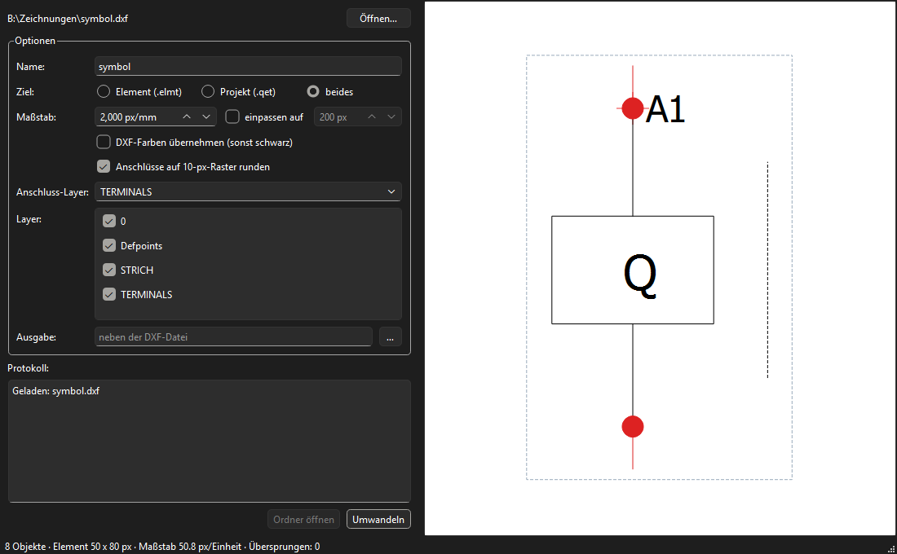

# dxf2qet – DXF nach QElectroTech

Wandelt DXF-Zeichnungen in **QElectroTech**-Dateien um:

- **Element (`.elmt`)** – ein Symbol für die eigene Sammlung (in QET: Sammlung › Benutzerelemente, Datei dort ablegen oder im Element-Editor öffnen)
- **Projekt (`.qet`)** – ein Schaltplan-Blatt, auf dem die Zeichnung als eingebettetes Element liegt



## Download

Unter [Releases](../../releases/latest) gibt es zwei Varianten für Windows 10/11 (64 Bit):

| Datei | Variante |
|---|---|
| `dxf2qet-Setup-<version>.exe` | Installer: installiert ohne Adminrechte, legt einen Startmenü-Eintrag und auf Wunsch ein Desktop-Symbol an, lässt sich über die Windows-Einstellungen wieder entfernen. Startet schnell. |
| `dxf2qet-<version>-portable.exe` | Portabel: eine einzelne Datei ohne Installation (z. B. für einen USB-Stick). Der Start dauert etwas länger, weil sie sich bei jedem Start nach `%TEMP%` entpackt. |

Eine DXF-Datei kann auch direkt auf das Programmsymbol gezogen werden.

Die Programme sind nicht signiert. Windows SmartScreen meldet deshalb beim ersten Start eventuell
„Der Computer wurde durch Windows geschützt“. Dann auf **Weitere Informationen › Trotzdem ausführen** klicken.

Fehler oder Wünsche bitte als [Issue](../../issues) melden.

## Start aus dem Quellcode

- Desktop-Verknüpfung **„DXF zu QElectroTech“** – eine DXF-Datei auf das Symbol ziehen öffnet sie direkt
- oder `start.ps1` (richtet beim ersten Mal `.venv` mit uv ein)
- Kommandozeile: `.\start.ps1 plan.dxf --to qet --scale 2 --out C:\Ziel`
  (`--to elmt|qet|both`, `--fit 200`, `--layers A,B`, `--terminal-layer TERMINALS`, `--colors`, `--no-snap`)

## Weitergeben ohne Python

`.\build.ps1` baut zwei Varianten für Windows 10/11 x64 (braucht Inno Setup 6: `winget install JRSoftware.InnoSetup --scope user`):

- `dist\dxf2qet-Setup-<version>.exe` – Installer aus dem Ordner-Build von PyInstaller (`packaging\setup.iss`)
- `dist\dxf2qet-<version>-portable.exe` – eine einzelne Datei ohne Installation, startet etwas langsamer (entpackt sich nach `%TEMP%`)

Fertige Builds werden als [Release](../../releases) in diesem Repo veröffentlicht.

## Was übernommen wird

LINE, ARC, CIRCLE, ELLIPSE, LWPOLYLINE/POLYLINE (Bögen/Bulges werden angenähert), SPLINE, TEXT, MTEXT,
ATTRIB, SOLID/TRACE/3DFACE, HATCH (Umriss, Vollfüllung), Blockreferenzen (INSERT, auch verschachtelt, gedreht,
skaliert), Bemaßungen und Führungslinien (in Linien/Text zerlegt).
Was nicht passt (z. B. POINT, MESH, Bilder), steht im Protokoll unter „Übersprungen“.

- **Maßstab:** Standard 2 px je mm (ein A3-Plan passt auf ein QET-Standardblatt). Einheit aus `$INSUNITS`.
  „Einpassen auf“ skaliert die größte Seite auf eine feste Pixelzahl – praktisch für Symbole.
- **Anschlüsse:** Punkte oder Kreise auf dem Layer `TERMINALS` (einstellbar) werden zu QET-Anschlüssen.
  Die Richtung ergibt sich aus der nächstgelegenen Seite der Zeichnung; optional aufs 10-px-Raster gerundet.
- **Linientypen:** DASHED/HIDDEN → gestrichelt, DOT → gepunktet, CENTER/DASHDOT → Strich-Punkt.
- **Farben:** standardmäßig schwarz, optional nächstliegende QET-Farbe.

## Entwicklung

```
uv sync
uv run pytest
uv run python tests/make_samples.py   # Beispiel-DXFs nach tests/samples
uv run python tools/screenshot.py tests/samples/symbol.dxf docs/screenshots/hauptfenster.png   # Screenshot für die README
```

Aufbau: `reader.py` (DXF → Primitive) → `transform.py` (Y-Spiegelung, Maßstab, Hotspot, Raster)
→ `qet_element.py` / `qet_project.py` (XML) · `gui.py` (PySide6, Vorschau zeichnet das erzeugte XML).
